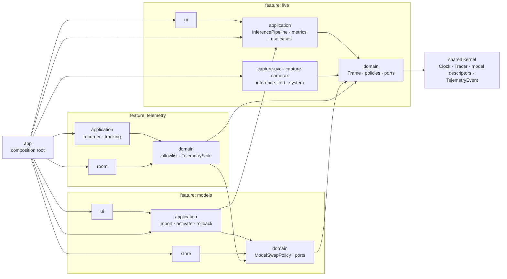

# Architecture — real-time on-device video inference (Android)

## Goal

Capture a live video feed (HDMI → USB/UVC capture card, CameraX as fallback), run an on-device model on it in real time, and display results that always match the image on screen. Stay light on CPU, GPU, memory and temperature over long sessions, and send metrics-only telemetry.

The code must be readable by the next engineer without a tour.

## Principles

- Feature-first hexagonal architecture (ADR-014): each feature keeps its own layers as separate modules, and dependencies point inward: `ui → application → domain ← adapters`, all of them on `shared:kernel`.
- Features depend on each other in one direction only: `models → live`, `telemetry → live, models`.
- Pure-Kotlin modules (`shared:*`, every `domain` and `application`): no `android.*`, no DI annotations. Only `kotlinx-coroutines-core` is allowed.
- Everything external sits behind a port: capture, inference runtime, model storage, thermal, memory, device info, telemetry transport, clock, tracing.
- Correctness before throughput: a result is never displayed on a frame it was not computed from.
- Measure before optimising. Every performance claim is backed by a trace in `docs/perf/`.



## Modules

```
:shared:kernel                  pure Kotlin — Clock, Tracer, model descriptors, TelemetryEvent, ScreenId, ElementId
:shared:testing                 pure Kotlin — a fake for every port + clocks (test fixtures)
:features:live:domain           pure Kotlin — frames, results, pipeline state, policies, ports, LiveTelemetry
:features:live:application      pure Kotlin — InferencePipeline, MetricsAggregator, Start/Stop/Observe/ReportFrameRendered
:features:live:capture-uvc      FrameSource over a USB/UVC capture card
:features:live:capture-camerax  FrameSource over CameraX (fallback, works without hardware)
:features:live:inference-litert InferenceEngine over LiteRT (GPU delegate, CPU/XNNPACK fallback)
:features:live:system           ThermalMonitor, MemoryPressureMonitor, DeviceInfoProvider, Clock, Tracer
:features:live:ui               live screen with synchronized overlay, debug HUD
:features:models:domain         pure Kotlin — ModelSource, ModelSwapPolicy, ports ModelRepository and AuditLog, ModelTelemetry
:features:models:application    pure Kotlin — ImportModel, ActivateModel, RollbackModel
:features:models:store          ModelRepository: versioned models on disk, signature check, atomic activate/rollback
:features:models:ui             models screen
:features:telemetry:domain      pure Kotlin — TelemetryAllowlist, port TelemetrySink
:features:telemetry:application pure Kotlin — TelemetryRecorder, TrackScreen, TrackUiInteraction
:features:telemetry:room        TelemetrySink: Room buffer + WorkManager batch upload
:app                            composition root (manual DI, `AppGraph`)
```

Optional: `:features:live:inference-onnx`, to prove the inference runtime is swappable without touching the domain.

Dependency rules (ADR-014, enforced by `verifyModuleBoundaries` and Konsist, ADR-006):
- A domain sees the kernel and the domains of upstream features; an application also sees its own domain and upstream applications.
- An adapter sees its feature's domain (and what that domain sees), never another adapter nor an application.
- A UI module sees its feature's application and domain.
- Only `:app` sees every module; it wires them in a single `AppGraph`.
- Each feature defines its own telemetry events; producers emit through a function wired in `:app`, so no feature depends on the telemetry feature.

## Domain

### Entities and value objects

- `FrameId`: monotonic within a session. `SessionId`: incremented on every (re)connection.
- `Frame(id, sessionId, captureTimestampNanos, width, height, image: ImageBuffer)`. `ImageBuffer` is a domain interface (format, planes, `close()` returns the buffer to its pool).
- `InferenceResult(frameId, sessionId, modelVersion, detections, inferenceNanos)`
- `Detection(box: NormalizedRect, label: LabelId, score: Float)`
- `ModelVersion`, `ModelManifest(version, sha256, signature, inputSpec, outputSpec)`, `ModelArtifact(manifest, location)`
- `PipelineState`: `Idle`, `Connecting`, `NoSignal(reason)`, `Running(rate)`, `Degraded(cause, rate)`, `Paused(cause)` (ADR-013)
- `ThermalLevel` (NONE … SHUTDOWN), `MemoryPressure` (NORMAL, MODERATE, CRITICAL)
- `TelemetryEvent`: an open interface in the kernel; each feature defines a sealed family of metrics-only events (see Telemetry, ADR-014)

### Policies (pure, unit-tested)

- `ResultDisplayPolicy`: a result is displayable only with the frame it was computed from (same `sessionId` and `frameId`). See ADR-001.
- `InferenceRatePolicy`: `(ThermalLevel, MemoryPressure) → target rate | pause`
- `ReconnectPolicy`: exponential backoff with a cap and jitter
- `ModelSwapPolicy`: a swap is allowed only when the pipeline is `Idle` or `NoSignal`, never during a session
- `TelemetryAllowlist`: only enumerated event types with primitive fields

### Ports

Driven (outbound), implemented by adapters. They live in `dev.framelock.<feature>.domain.port` (or `dev.framelock.kernel.port` for `Clock` and `Tracer`), are plain (not `fun`) interfaces, and value types that travel through them (e.g. `SourceEvent`) are sealed:

```kotlin
interface FrameSource {
    val events: Flow<SourceEvent>
    suspend fun open()
    suspend fun close()
}

sealed interface SourceEvent {
    data class Connected(val spec: StreamSpec, val sessionId: SessionId) : SourceEvent  // adapter allocates the session
    data class FrameAvailable(val frame: Frame) : SourceEvent
    data class Disconnected(val reason: DisconnectReason) : SourceEvent
}

interface InferenceEngine : AutoCloseable {
    val dispatcher: CoroutineDispatcher      // single thread created by the adapter (ADR-002)
    suspend fun load(model: ModelArtifact)   // includes warm-up
    fun infer(frame: Frame): InferenceResult // blocking, always called on the inference thread
}

interface ModelRepository {
    fun active(): ModelArtifact?
    fun previous(): ModelArtifact?
    fun artifact(version: ModelVersion): ModelArtifact?
    fun list(): List<ModelManifest>
    suspend fun import(source: ModelSource): Result<ModelManifest>
    suspend fun activate(version: ModelVersion): Result<Unit>
    suspend fun rollback(): Result<Unit>
}

interface ThermalMonitor { val level: Flow<ThermalLevel> }
interface MemoryPressureMonitor { val pressure: Flow<MemoryPressure> }
interface DeviceInfoProvider { fun snapshot(): DeviceSnapshot }
interface TelemetrySink { fun record(event: TelemetryEvent) }
interface Clock { fun nowNanos(): Long }
interface Tracer { fun begin(section: TraceSection); fun end() }  // + inline Tracer.trace(section) { } (ADR-009)
interface AuditLog { fun record(entry: AuditEntry) }                // ADR-003
```

Driving (inbound): the use cases of each feature's `application` module: `StartPipeline`, `StopPipeline`, `ObservePipeline`, `ReportFrameRendered` (ADR-011), `ImportModel`, `ActivateModel`, `RollbackModel`, `TrackScreen`, `TrackUiInteraction`.

## Pipeline (`:features:live:application`)

```
FrameSource ──events──▶ InferencePipeline
                          │ drop late frames and frames from a previous session
                          │ conflate (latest frame wins)
                          │ throttle (InferenceRatePolicy)
                          ▼
              dedicated inference thread
                          ▼
     AnnotatedFrame(frame, result) ──▶ StateFlow<PipelineUiState> ──▶ UI
                          └──▶ MetricsAggregator ──▶ TelemetrySink (windowed)
```

Rules:
1. One inference at a time, on a dedicated single thread created by the engine adapter (`Executors.newSingleThreadExecutor().asCoroutineDispatcher()`, exposed as `InferenceEngine.dispatcher`), not `limitedParallelism(1)`: the GPU delegate must be created and invoked on the same thread. The pipeline runs `load`, `infer` and `close` on that dispatcher; the thread lives as long as the engine, so a model swap while idle stays on it (ADR-002).
2. Latest frame wins. Frames arriving during an inference are conflated; dropped frames are counted and their buffers released immediately.
3. A frame older than the last processed one, or from a previous session, is dropped.
4. On `Disconnected`: state becomes `NoSignal`, and the current result is cleared in the same emission. An in-flight result is discarded on arrival (session mismatch). Reconnection follows `ReconnectPolicy`: one loop at a time, whose backoff resets only once frames flow again; a refused permission is not retried. A failing event flow counts as a disconnection (`STREAM_ERROR`).
5. Under memory or thermal pressure, the pipeline lowers its rate or pauses, as `InferenceRatePolicy` decides, and the state says why. It degrades; it never crashes.
6. Every buffer is released in a `finally`. No per-frame allocation in steady state.
7. `Tracer` sections around capture, preprocess, inference, postprocess and render.

## Display (ADR-001)

The UI draws the analysed frame and its overlay together: what you see is what was analysed. The cost is that display latency equals inference latency, which is why keeping inference fast matters.

Rejected alternative: live preview plus an overlay hidden when too old. With fast camera motion, the overlay drifts from the object it describes.

## Model management

- Models live outside the APK: `filesDir/models/<version>/{model.tflite, manifest.json}`, plus an `active` pointer file.
- Import (in the demo, from a file picker): copy to a temp dir → verify SHA-256 and the ECDSA P-256 signature (`SHA256withECDSA`) against a public key embedded in the app → atomic move.
- Activate: only when `ModelSwapPolicy` allows it. The pipeline swaps atomically under its lifecycle lock (`ModelLoading.swapModel`): the engine loads and warms up the new model, then the repository switches its pointer; if either fails, the previous model is loaded back and the failure is audited. No session can start in the middle.
- Rollback: the previous version stays on disk.
- Every import, activation, rejection and rollback emits telemetry and an audit entry.
- `scripts/sign-model.sh` signs a model with a private key kept out of the repo.

## Telemetry

- Typed events only. No free text, no images, no personal data:
  - `AppSession`
  - `ScreenViewed(ScreenId)`, `UiInteraction(ElementId)`
  - `PipelineWindow(inferenceMsP50, inferenceMsP95, e2eMsP50, e2eMsP95, inputFps, inferenceFps, droppedFrames)`
  - `DeviceSnapshotRecorded(model, osVersion, batteryPct, batteryTempC, thermalLevel)`
  - `ModelSwapped(from, to)`, `ModelImported(version)`, `ModelRejected(reason)`, `PipelineDegraded(cause)`
- `ScreenId` and `ElementId` are enums: tracking a new element is a reviewed code change.
- `MetricsAggregator` aggregates over 10 s windows. No per-frame events.
- End-to-end latency = render time − capture timestamp, on the same clock (`elapsedRealtimeNanos`).
- Battery temperature comes from the sticky `ACTION_BATTERY_CHANGED` intent (`EXTRA_TEMPERATURE`, tenths of °C).
- Adapter: capped Room table (oldest events dropped first), periodic WorkManager batch upload with a network constraint, gzipped JSON. `LoggingUploader` by default, `HttpUploader` behind a config flag.

## UI (Compose)

- Live screen: video with overlay, plus a large status banner (Running / No signal / Degraded: thermal / Model vX).
- Built for a two-second glance and imprecise touch: touch targets ≥ 64 dp, WCAG AA contrast at least, no critical action behind a small tap, no gesture-only actions.
- Debug HUD (toggle): input fps, inference fps, inference ms, e2e ms, thermal level, dropped frames.
- Models screen: list, activate, rollback, disabled whenever `ModelSwapPolicy` says no.
- Bitmaps reused (double buffer): no allocation per frame.
- `Modifier.track(ElementId)` routes clicks to `TrackUiInteraction`.

## Tests (where a failure matters)

- Domain: every policy.
- Application (`kotlinx-coroutines-test`, fakes, virtual time):
  - result cleared on disconnect;
  - result from a previous session discarded;
  - late frames dropped;
  - latest frame wins with a slow engine (dropped count correct, every buffer released);
  - pause and resume under thermal and memory pressure;
  - model swap refused while running;
  - aggregator maths;
  - telemetry allowlist.
- Adapters:
  - model store: bad signature rejected, atomic activation, rollback;
  - telemetry: cap and batching;
  - LiteRT golden test on a fixed image, with tolerance (instrumented).
- Architecture (Konsist): no `android.*` in core, adapters independent from each other, ports implemented only in adapters.
- UI: "No signal" banner shown and overlay hidden on disconnect.

Each requirement links to its tests in `docs/traceability.md`.

## Performance method

1. Baseline: Perfetto system trace (CPU frequencies, GPU, thermal), memory profiler, 10-minute run on a fixed input video.
2. One change at a time, re-traced, logged in `docs/perf/results.md` (before/after: inference p50/p95, e2e p50/p95, CPU %, PSS, temperature after 10 minutes).
3. Candidates: GPU delegate vs CPU, input resolution, zero-copy YUV → tensor, MJPEG decoding cost from the capture card, inference rate cap, buffer pooling.

## Delivery

- GitHub Actions: build, unit tests, detekt/ktlint, Konsist; release APK as an artifact on tag.
- Docs: README (running in 5 minutes), this file, `docs/adr/`, `docs/perf/`, `docs/traceability.md`, `docs/soup.md` (third-party libraries: version, purpose, licence).

## ADRs

- ADR-001: synchronized display of the analysed frame and its result
- ADR-002: one inference at a time on a dedicated thread, latest frame wins
- ADR-003: models outside the APK, signed, swapped only when idle
- ADR-004: telemetry as a typed allowlist, aggregated in windows
- ADR-005: no NNAPI (deprecated since Android 15): GPU delegate with CPU fallback
- ADR-006: module boundaries enforced by a Gradle plugin and by Konsist
- ADR-007: test frameworks: JUnit Jupiter on the JVM, JUnit 4 instrumented, no Robolectric
- ADR-008: static analysis: Android Lint, ktlint (Spotless), detekt on pure-Kotlin modules only
- ADR-009: Tracer port without per-frame allocation
- ADR-010: frame buffer ownership (source → pipeline → display slot)
- ADR-011: clock base and end-to-end latency
- ADR-012: scope of "no per-frame allocation"
- ADR-013: inference rate and degradation table

## Out of scope

Real personal data, integration with external systems, cloud backend.
