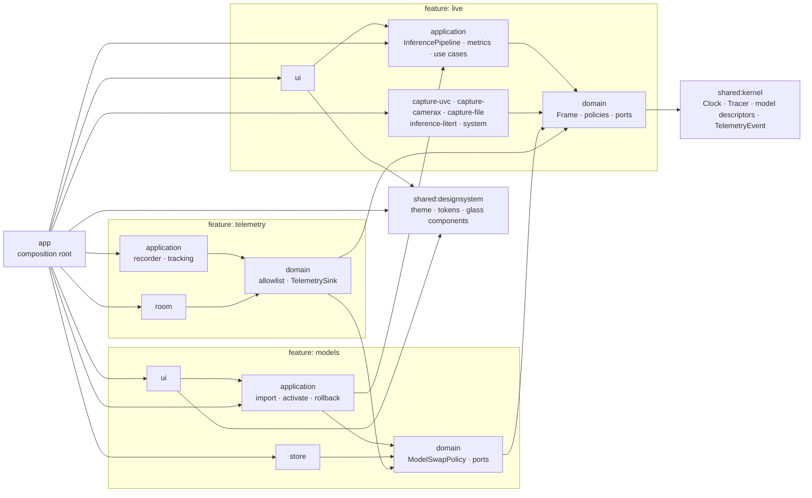

# Architecture — real-time on-device video inference (Android)

## Goal

Capture a live video feed (HDMI → USB/UVC capture card, CameraX as fallback), run an on-device model on it in real time, and display results that always match the image on screen. Stay light on CPU, GPU, memory and temperature over long sessions, and send metrics-only telemetry.

The code must be readable by the next engineer without a tour.

## Principles

- Feature-first hexagonal architecture (ADR-014): each feature keeps its own layers as separate modules, and dependencies point inward: `ui → application → domain ← adapters`, all of them on `shared:kernel`.
- Features depend on each other in one direction only: `models → live`, `telemetry → live, models`.
- Pure-Kotlin modules (`shared:kernel`, `shared:testing`, every `domain` and `application`): no `android.*`, no DI annotations. Only `kotlinx-coroutines-core` is allowed.
- Everything external sits behind a port: capture, inference runtime, model storage, thermal, memory, device info, telemetry transport, clock, tracing.
- Correctness before throughput: a result is never displayed on a frame it was not computed from.
- Measure before optimising. Every performance claim is backed by a trace in `docs/perf/`.



## Modules

```
:shared:kernel                  pure Kotlin — Clock, Tracer, model descriptors, TelemetryEvent, ScreenId, ElementId
:shared:testing                 pure Kotlin — a fake for every port + clocks (test fixtures)
:shared:designsystem            Android Compose — theme, tokens, fonts, icons and glass component catalogue
:features:live:domain           pure Kotlin — frames, results, pipeline state, policies, ports, LiveTelemetry
:features:live:application      pure Kotlin — InferencePipeline, MetricsAggregator, Start/Stop/Observe/ReportFrameRendered
:features:live:capture-uvc      FrameSource over a USB/UVC capture card (UVCAndroid, ADR-016)
:features:live:capture-camerax  FrameSource over CameraX (fallback, works without hardware)
:features:live:capture-file     FrameSource over an H.264 MP4 played in a loop (debug/benchmark, M7; ADR-014 amendment)
:features:live:inference-litert InferenceEngine over LiteRT (GPU delegate, CPU/XNNPACK fallback)
:features:live:system           ThermalMonitor (status + headroom), MemoryPressureMonitor (trim + MemoryInfo), DeviceInfoProvider, Clock, Tracer (ADR-017)
:features:live:ui               live screen with synchronized overlay, debug HUD
:features:models:domain         pure Kotlin — ModelSource, ModelSwapPolicy, ports ModelRepository and AuditLog, ModelTelemetry
:features:models:application    pure Kotlin — ImportModel, ActivateModel, RollbackModel
:features:models:store          ModelRepository and AuditLog: versioned models on disk, signature check, atomic activate/rollback, labels
:features:models:ui             models screen
:features:telemetry:domain      pure Kotlin — TelemetryAllowlist, TelemetryBatch, ports TelemetrySink and TelemetryUploader
:features:telemetry:application pure Kotlin — TelemetryRecorder, TrackScreen, TrackUiInteraction
:features:telemetry:room        TelemetrySink: Room buffer + WorkManager batch upload, LoggingUploader
:app                            composition root (Koin modules, startup orchestration and typed navigation)
```

Optional: `:features:live:inference-onnx`, to prove the inference runtime is swappable without touching the domain.

Dependency rules (ADR-014, enforced by `verifyModuleBoundaries` and Konsist, ADR-006):
- A domain sees the kernel and the domains of upstream features; an application also sees its own domain and upstream applications.
- An adapter sees its feature's domain (and what that domain sees), never another adapter nor an application.
- A UI module sees its feature's application and domain, upstream inward layers, and the shared design system.
- Only `:app` sees all production modules; its Koin modules wire them. The design system reaches only the kernel.
- Each feature defines its own telemetry events; producers emit through a function wired in `:app`, so no feature depends on the telemetry feature.

## Composition and navigation (ADR-018)

`:app/di` contains System, Telemetry, Live, Models and Navigation modules, included by `appModule`. The application
starts the container before startup work. The pipeline, engine, source selection, monitors, repository, audit,
telemetry sink and application coroutine scope retain their application lifetimes. Named classes handle model
bootstrap and labels, model listing and swap availability, source wiring, debug launch extras and upload scheduling.
The existing telemetry worker factory is resolved through `Configuration.Provider`.

`KoinGraphTest` verifies constructor dependencies across the whole module tree and proves an incomplete graph fails.
Android context, callbacks and values built inside definitions are explicitly exempted; reflection verification does
not execute Android services or inspect arbitrary `get()` calls inside factories. Device startup remains a separate check.

`AppRoutes.Live` and `AppRoutes.Models` are serializable destinations. Each feature has a graph extension under
`navigation/routes`, where its activity-owned ViewModel is resolved, flows collected and Android interactions handled.
Screens receive state and callbacks. `AppNavigator` is a singleton command queue; `redirectOf` is the pure guard
function (currently identity). `AppNavHost` collects while started, applies single-top navigation and tracks the actual
destination. System back returns to Live, and consumed commands do not replay after rotation. Camera permission and
debug launch behavior stay at the app boundary.

## Domain

### Entities and value objects

- `FrameId`: monotonic within a session. `SessionId`: incremented on every (re)connection, from one `SessionIdSequence` shared by all sources.
- `Frame(id, sessionId, captureTimestampNanos, width, height, image: ImageBuffer)`. `ImageBuffer` is a domain interface (format, planes, `close()` returns the buffer to its pool).
- `InferenceResult(frameId, sessionId, modelVersion, detections, inferenceNanos)`
- `Detection(box: NormalizedRect, label: LabelId, score: Float)`
- `ModelVersion`, `ModelManifest(version, sha256, signature, inputSpec, outputSpec)`, `ModelArtifact(manifest, location)`
- `PipelineState`: `Idle`, `Connecting`, `NoSignal(reason)`, `Running(rate)`, `Degraded(cause, rate)`, `Paused(cause)` (ADR-013)
- `ThermalLevel` (NONE … SHUTDOWN), `MemoryPressure` (NORMAL, MODERATE, CRITICAL)
- `TelemetryEvent`: an open interface in the kernel; each feature defines a sealed family of metrics-only events (see Telemetry, ADR-014)

### Policies (pure, unit-tested)

- `ResultDisplayPolicy`: a result is displayable only with the frame it was computed from (same `sessionId` and `frameId`). See ADR-001.
- `InferenceRatePolicy`: `(ThermalLevel, MemoryPressure) → target rate | pause`
- `ReconnectPolicy`: exponential backoff with a cap and jitter
- `ModelSwapPolicy`: a swap is allowed only when the pipeline is `Idle` or `NoSignal`, never during a session
- `TelemetryAllowlist`: only enumerated event types with primitive fields

### Ports

Driven (outbound), implemented by adapters. They live in `dev.framelock.<feature>.domain.port` (or `dev.framelock.kernel.port` for `Clock` and `Tracer`), are plain (not `fun`) interfaces, and value types that travel through them (e.g. `SourceEvent`) are sealed:

```kotlin
interface FrameSource {
    val events: Flow<SourceEvent>
    suspend fun open()
    suspend fun close()
}

sealed interface SourceEvent {
    data class Connected(val spec: StreamSpec, val sessionId: SessionId) : SourceEvent  // adapter allocates the session
    data class FrameAvailable(val frame: Frame) : SourceEvent
    data class Disconnected(val reason: DisconnectReason) : SourceEvent
}

interface InferenceEngine : AutoCloseable {
    val dispatcher: CoroutineDispatcher      // single thread created by the adapter (ADR-002)
    suspend fun load(model: ModelArtifact)   // includes warm-up
    fun infer(frame: Frame): InferenceResult // blocking, always called on the inference thread
}

interface ModelRepository {
    fun active(): ModelArtifact?
    fun previous(): ModelArtifact?
    fun artifact(version: ModelVersion): ModelArtifact?
    fun list(): List<ModelManifest>
    suspend fun import(source: ModelSource): Result<ModelManifest>
    suspend fun activate(version: ModelVersion): Result<Unit>
    suspend fun rollback(): Result<Unit>
}

interface ThermalMonitor { val level: Flow<ThermalLevel> }
interface MemoryPressureMonitor { val pressure: Flow<MemoryPressure> }
interface DeviceInfoProvider { fun snapshot(): DeviceSnapshot }
interface TelemetrySink { fun record(event: TelemetryEvent) }
interface TelemetryUploader { suspend fun upload(batch: TelemetryBatch): Boolean }  // ADR-004 (M6)
interface Clock { fun nowNanos(): Long }
interface Tracer { fun begin(section: TraceSection); fun end() }  // + inline Tracer.trace(section) { } (ADR-009)
interface AuditLog { fun record(entry: AuditEntry) }                // ADR-003
```

Driving (inbound): the use cases of each feature's `application` module: `StartPipeline`, `StopPipeline`, `ObservePipeline`, `ReportFrameRendered` (ADR-011), `ImportModel`, `ActivateModel`, `RollbackModel`, `TrackScreen`, `TrackUiInteraction`.

## Pipeline (`:features:live:application`)

```
FrameSource ──events──▶ InferencePipeline
                          │ drop late frames and frames from a previous session
                          │ conflate (latest frame wins)
                          │ throttle (InferenceRatePolicy)
                          ▼
              dedicated inference thread
                          ▼
     AnnotatedFrame(frame, result) ──▶ StateFlow<PipelineUiState> ──▶ UI
                          └──▶ MetricsAggregator ──▶ TelemetrySink (windowed)
```

Rules:
1. One inference at a time, on a dedicated single thread created by the engine adapter (`Executors.newSingleThreadExecutor().asCoroutineDispatcher()`, exposed as `InferenceEngine.dispatcher`), not `limitedParallelism(1)`: the GPU delegate must be created and invoked on the same thread. The pipeline runs `load`, `infer` and `close` on that dispatcher; the thread lives as long as the engine, so a model swap while idle stays on it (ADR-002).
2. Latest frame wins. Frames arriving during an inference are conflated; dropped frames are counted and their buffers released immediately.
3. A frame older than the last processed one, or from a previous session, is dropped.
4. On `Disconnected`: state becomes `NoSignal`, and the current result is cleared in the same emission. An in-flight result is discarded on arrival (session mismatch). Reconnection follows `ReconnectPolicy`: one loop at a time, whose backoff resets only once frames flow again; a refused permission is not retried. A failing event flow counts as a disconnection (`STREAM_ERROR`). A source reports why it lost the stream (`DisconnectReason`: `DEVICE_DETACHED`, `STREAM_ERROR`, `PERMISSION_DENIED`, `OPEN_FAILED`, `SIGNAL_LOST` for a device that stopped sending frames); every reason but `PERMISSION_DENIED` is retried.
5. Under memory or thermal pressure, the pipeline lowers its rate or pauses, as `InferenceRatePolicy` decides, and the state says why. It degrades; it never crashes.
6. Every buffer is released in a `finally`. No per-frame allocation in steady state.
7. `Tracer` sections around capture, preprocess, inference, postprocess and render.

## Display (ADR-001)

The UI draws the analysed frame and its overlay together: what you see is what was analysed. The cost is that display latency equals inference latency, which is why keeping inference fast matters.

Rejected alternative: live preview plus an overlay hidden when too old. With fast camera motion, the overlay drifts from the object it describes.

## Model management

- Models live outside the APK: `filesDir/models/<version>/{model.tflite, manifest.properties, manifest.sig, labels.txt?}`, with `filesDir/model-state/{active,previous}` pointer files (ADR-003, amendment M5).
- A model travels as one `.flmodel` file: a zip of those files. `manifest.properties` holds the version, the SHA-256 of the model (and labels) and the tensor specs; `manifest.sig` is an ECDSA P-256 signature of its exact bytes, so one signature covers the manifest, the model and the labels.
- Import (in the demo, from a file picker): unpack into a staging directory under the zip rules (known names, size limits) → verify the signature against the public keys embedded in the app (`assets/keys`) → check the SHA-256 of the model and labels → atomic move.
- Activate: only when `ModelSwapPolicy` allows it. The pipeline swaps atomically under its lifecycle lock (`ModelLoading.swapModel`): the engine loads and warms up the new model, then the repository switches its pointer; if either fails, the previous model is loaded back and the failure is audited. No session can start in the middle.
- Rollback: the previous version stays on disk.
- Every import, activation, rejection and rollback emits telemetry and an audit entry.
- `scripts/sign-model.sh` creates a key pair and signs a model with a private key kept out of the repo.
- The audit trail is `filesDir/audit/audit.log` (capped, rotated once): wall-clock time, action, version, outcome, reason. Debug builds bundle a signed package that is imported and activated through the use cases at first start.

## Telemetry

- Typed events only. No free text, no images, no personal data:
  - `AppSession`
  - `ScreenViewed(ScreenId)`, `UiInteraction(ElementId)`
  - `PipelineWindow(inferenceMsP50, inferenceMsP95, e2eMsP50, e2eMsP95, inputFps, inferenceFps, droppedFrames)`
  - `DeviceSnapshotRecorded(model, osVersion, batteryPct, batteryTempC, thermalLevel)`
  - `ModelSwapped(from, to)`, `ModelImported(version)`, `ModelRejected(reason)`, `PipelineDegraded(cause)`
- `ScreenId` and `ElementId` are enums: tracking a new element is a reviewed code change.
- `MetricsAggregator` aggregates over 10 s windows. No per-frame events.
- End-to-end latency = render time − capture timestamp, on the same clock (`elapsedRealtimeNanos`).
- Battery temperature comes from the sticky `ACTION_BATTERY_CHANGED` intent (`EXTRA_TEMPERATURE`, tenths of °C).
- Adapter: capped Room table (10 000 rows, oldest events dropped first), periodic WorkManager batch upload (every 15 min, network constraint, 500 events per gzipped JSON array), `LoggingUploader` by default. `HttpUploader` behind a config flag is future work (ADR-004, M6).
- A stored event is one JSON object, `{"type":"<EventName>","atMillis":<wall clock>, ...fields}`. `TelemetrySink.record` never blocks its caller: events go through a bounded queue to one writer coroutine.

## UI (Compose)

- Style: frosted glass over the video. Panels are blurred, translucent and rounded (28 dp, a 1 dp white edge at 14%, a soft shadow); chips and round buttons are fully rounded; one cyan-to-violet gradient marks the primary action and the selected states; the font is Inter. The blur source is the video area (`hazeSource`, Haze, `docs/soup.md`); the panels are siblings of it, never inside it. Blur needs API 31; below that a panel is a flat translucent fill. Because the picture behind a panel is unknown, the panel is darkened under its tint so white text reaches AA even over a white picture (`GlassPalette`, `GlassPaletteTest`). `:shared:designsystem` owns all primitives and tokens. Internal bases implement public button, card and chip variants. Video and app-gradient panels preserve distinct tints and API 29–30 fallback fills.
- Live screen: the analysed frame fills the screen, letterboxed on black to its own aspect ratio (what you see is what was analysed, ADR-001), edge to edge under transparent system bars; every overlay pads itself by the window insets, display cutouts included.
  - Status: a glass bar at the top holds the state as a filled pill in the state colour with dark text (20 sp SemiBold, AA by construction, a pulsing dot while running; the colour crossfades in 200 ms), the model version, and, while the HUD is off, a compact "fps · ms" readout. A missing or unloadable model is explained in a glass card right under it.
  - Detections: rounded boxes (14 dp) in a fixed per-class colour with a soft glow of the same colour; a label pill (black at 60%, a dot in the class colour, white text) at the box's top-left corner, moved inside or below the box when it would leave the frame. Boxes and frame go through the same fit.
  - Controls: Start/Stop is the primary button (64 dp high, icon and text): the gradient with dark content to start, red glass to stop, crossfading. The source picker is a glass chip (camera, current choice, chevron); the debug HUD toggle and Models are 64 dp round glass buttons (the HUD ring is the gradient while it is on). Every control is at least 64 dp and springs to 96% while pressed. Portrait: a glass dock floating over the bottom of the video, above the navigation inset. Landscape (the capture-card case): a glass rail beside the video, so it never covers part of the analysed frame.
  - Stopped with nothing to draw: a gradient background and a centred glass card ("Ready", what to press) instead of a black void.
- Built for a two-second glance and imprecise touch: touch targets ≥ 64 dp, WCAG AA contrast at least, no critical action behind a small tap, no gesture-only actions.
- Source picker (button in the controls, enabled only while stopped; a change applies at the next start): Auto, back, front, external camera, each attached UVC device.
- Debug HUD (toggle): a glass card under the status bar (one column at the top-end in portrait, two columns in landscape to keep every row visible), with labelled rows in sections (secondary label, primary value in tabular figures): active source and, for UVC, capture mode; input fps, inference fps; inference ms, e2e ms, dropped frames; thermal level, memory pressure.
- Models screen: same language on the app gradient. A glass top bar with a back arrow floats over the list, one glass card per version (an Active chip edged with the gradient, a Previous chip, an Activate pill), the last outcome or the reason the actions are off in a glass status card, and a glass dock at the bottom with Roll back (glass) and Import model (gradient); disabled whenever `ModelSwapPolicy` says no. Before the camera permission is granted, a centred glass card explains why and offers one gradient button.
- One dark `FramelockTheme` in `:shared:designsystem` (colour scheme, Inter typography: display 28 SemiBold, title 20 SemiBold, body 16, label 14 Medium; shapes); screens read `MaterialTheme` tokens for type. The glass colours, the gradient, the status colours and the detection class palette are fixed colours, because they carry meaning or must hold a contrast whatever the picture. Digits that change (HUD, readout, detection labels) use tabular figures. Icons are Material Symbols vector drawables (`docs/soup.md`).
- Thin screens accept immutable UI state and event callbacks. Components live under `ui/components`, one public type or composable per matching file, at most 400 lines. ViewModels stay in app routes. No private top-level helpers in screen files.
- Catalogue: PrimaryButton (gradient), DangerButton (red glass), GhostButton, AppIconButton (normal/selected), StatusChip (state/pulse), SelectionChip (active/previous), AppCard, AppTopBar, AppDropdown, EmptyState (floating/panel), AppLoader and StatusMessage. Each has a preview. Screen previews cover stopped, running/HUD, source menu, landscape and Models active/previous/disabled/busy/empty states.
- Feature UI uses design-system dimensions and colours, with `0.dp` the only literal dimension exception. Direct Material button/card/menu/input/progress primitives and literal visible text are forbidden by Konsist and negative fixtures.
- Every interface string has a `<feature>_<screen>_<element>` resource key and a French translation. Tests compare key sets and placeholders. Configuration changes refresh built-in source labels while retaining source identity; model labels and device names remain supplied data.
- Bitmaps reused (double buffer): no allocation per frame. Detection text layout caching, `DisplaySlot.read` locking and RENDER tracing are retained. Localized detection-label formatting runs only on a cache miss.
- `Modifier.track(ElementId)` routes clicks to `TrackUiInteraction`.

## Tests (where a failure matters)

- Domain: every policy.
- Application (`kotlinx-coroutines-test`, fakes, virtual time):
  - result cleared on disconnect;
  - result from a previous session discarded;
  - late frames dropped;
  - latest frame wins with a slow engine (dropped count correct, every buffer released);
  - pause and resume under thermal and memory pressure;
  - model swap refused while running;
  - aggregator maths;
  - telemetry allowlist.
- Adapters:
  - model store: bad signature rejected, atomic activation, rollback;
  - telemetry: cap and batching;
  - LiteRT golden test on a fixed image, with tolerance (instrumented).
- Architecture: Gradle reach and external-library rules; Konsist purity, app-only DI, ports and UI rules with failing fixtures; resource key and French-placeholder checks.
- UI: "No signal" banner shown and overlay hidden on disconnect.

Each requirement links to its tests in `docs/traceability.md`.

## Performance method

1. Baseline: Perfetto system trace (CPU frequencies, GPU, thermal), memory profiler, 10-minute run on a fixed input video.
2. One change at a time, re-traced, logged in `docs/perf/results.md` (before/after: inference p50/p95, e2e p50/p95, CPU %, PSS, temperature after 10 minutes).
   The tooling (M7, step 1) is in `scripts/perf/` and described in `docs/perf/README.md`: a fixed input video played by `capture-file`, a scripted run (`run.sh`) with a cool-down gate, a Perfetto trace, and a summary row in `results.md`.
3. Candidates: GPU delegate vs CPU, input resolution, zero-copy YUV → tensor, MJPEG decoding cost from the capture card, inference rate cap, buffer pooling.

## Delivery

- GitHub Actions: build, unit tests, detekt/ktlint, Konsist; release APK as an artifact on tag.
- Docs: README (running in 5 minutes), this file, `docs/adr/`, `docs/perf/`, `docs/traceability.md`, `docs/soup.md` (third-party libraries: version, purpose, licence).

## ADRs

- ADR-001: synchronized display of the analysed frame and its result
- ADR-002: one inference at a time on a dedicated thread, latest frame wins
- ADR-003: models outside the APK, signed, swapped only when idle
- ADR-004: telemetry as a typed allowlist, aggregated in windows
- ADR-005: no NNAPI (deprecated since Android 15): GPU delegate with CPU fallback
- ADR-006: module boundaries enforced by a Gradle plugin and by Konsist
- ADR-007: test frameworks: JUnit Jupiter on the JVM, JUnit 4 instrumented, no Robolectric
- ADR-008: static analysis: Android Lint, ktlint (Spotless), detekt on pure-Kotlin modules only
- ADR-009: Tracer port without per-frame allocation
- ADR-010: frame buffer ownership (source → pipeline → display slot)
- ADR-011: clock base and end-to-end latency
- ADR-012: scope of "no per-frame allocation"
- ADR-013: inference rate and degradation table
- ADR-016: UVC capture, source selection and shared session ids
- ADR-017: system adapters: thermal headroom forecast and memory pressure signals
- ADR-018: application composition and typed navigation
- ADR-019: shared glass design system and enforced UI rules

## Out of scope

Real personal data, integration with external systems, cloud backend.
