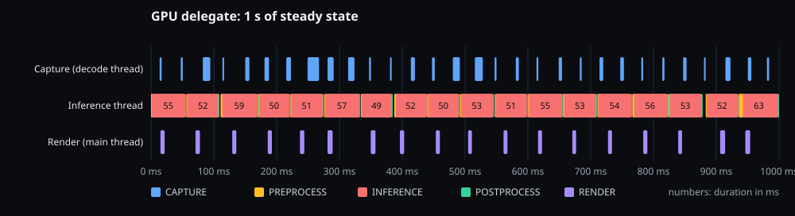
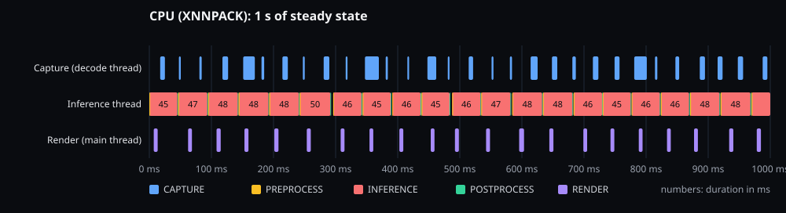

# GPU delegate versus CPU (XNNPACK)

**Question.** Does running the detection model on the GPU delegate make the live loop faster than running it on the
CPU with XNNPACK?

**Answer, on this device and this model: yes, modestly, and it frees the CPU.** Over 10 minutes the GPU delegate is
about 9 % faster at the median inference and 20 % steadier at p95, analyses 11 % more frames, and uses 60 percentage
points of CPU less; it costs about 65 MB of memory. In the first minute of a cool phone the CPU path is as fast or
faster: the GPU's advantage is under sustained load. The numbers below are from one mid-range phone, not from the
target hardware: the method carries over, the absolute values will not.

## Setup

> Exception to the repository rule against product names (decided by the project owner): this document names the
> test device and its chip, because the results cannot be read without them. Nowhere else does.

| | |
|---|---|
| Device | Samsung Galaxy A33 5G (SM-A336B), 6 GB RAM, Android 16 (SDK 36) |
| Chip | Exynos 1280: 2 × Cortex-A78 up to 2.4 GHz, 6 × Cortex-A55 up to 2.0 GHz; GPU Mali-G68 (OpenCL) |
| Model | EfficientDet-Lite0, quantised (uint8 input `[1, 320, 320, 3]`), 267 graph nodes, detection post-processing op included |
| Runtime | LiteRT 1.4.2. GPU: `GpuDelegate` with the device's best options. CPU: XNNPACK, 4 threads requested |
| Input | `classroom.mp4`, 1920 × 1080 H.264 at 30 fps, played in a loop by the `capture-file` source (see [results.md](results.md)) |
| App | debug build, app code of commit `2751cb1` (the three M7 optimisations); HUD on; backend forced with the debug launch extra |

## Protocol

- Same input video, same app build, same screen and power state (screen on, powered over USB) for both runs.
- Warm-up excluded twice: the engine runs one inference at load (it compiles the GPU kernels before the first real
  frame), and the summary ignores the first 30 s of each run.
- 10 minutes per run, so heat and throttling show up; latency figures are the median of the 10 s windows.
- Start conditions: thermal status 0 for both. The battery started at **33.8 °C for the GPU run and 30.4 °C for the
  CPU run** (the phone cannot cool much while charging over USB). The warmer start penalises the GPU run, which still
  comes out ahead.
- A first GPU run was discarded: its launch command blocked with the screen off while the app already ran, so it
  covered 20 minutes instead of 10. The run script no longer waits on the launch, and the summary now counts only the
  windows within the requested duration.
- What the engine actually ran is read from its log (`LiteRtEngine`: `Backend GPU` / `Backend CPU`), not assumed.

Reproduce:

```bash
./scripts/perf/run.sh backend-gpu 600 --backend gpu
./scripts/perf/run.sh backend-cpu 600 --backend cpu
```

## Results (10 minutes each)

| | GPU delegate | CPU (XNNPACK) |
|---|---|---|
| Inference p50 / p95 | **62.9 / 70.4 ms** | 69.0 / 87.6 ms |
| End to end p50 / p95 | **119.1 / 140.4 ms** | 127.7 / 155.8 ms |
| Inferences per second (input 30 fps) | **14.4** | 13.0 |
| Frames not analysed (latest frame wins, ADR-002) | 8 949 | 8 772 |
| App CPU, % of one core | **190 %** | 249 % |
| PSS at the end | 327 MB | **262 MB** |
| CPU sensor start → end | 35.4 → 43.5 °C | 32.7 → 43.2 °C |
| Thermal status at the end | 1 (light) | 1 (light) |

## What the traces show

INFERENCE encloses PREPROCESS and POSTPROCESS (the engine traces them inside `infer()`), so the model itself takes
INFERENCE minus the two.

Per-section durations from the full Perfetto traces (median / p95, ms). The GPU trace covers the whole run (625 s);
the CPU trace stopped at the run script's 1 GiB file cap after about 7.5 minutes, so its figures miss the warmest part
of the run, which flatters the CPU slightly.

| Section | Thread | GPU | CPU |
|---|---|---|---|
| CAPTURE | decode | 5.7 / 14.4 | 8.5 / 20.8 |
| PREPROCESS | inference | 2.0 / 4.9 | 1.7 / 5.3 |
| INFERENCE | inference | 65.4 / 79.0 | **56.5** / 94.9 |
| POSTPROCESS | inference | 0.2 / 0.4 | 0.2 / 0.3 |
| RENDER | main | 9.8 / 12.6 | 8.0 / 12.7 |

The CPU path wins at the median while the phone is cooler and loses at p95; over the full 10 minutes the app's own
windows (table above) put the GPU ahead on both.

CPU used by the busiest threads of the app, in cores (CPU seconds divided by the traced seconds), from the scheduler
data:

| Thread | GPU run | CPU run | Reading |
|---|---|---|---|
| `inference` | 0.32 | **0.87**, 98 % of it on the big cores | on the CPU the model keeps one big core busy; on the GPU the thread mostly waits |
| `mali-cmar-backe` (GPU driver) | 0.16 | 0.20 | busy in both runs: part of the GPU work is the interface (likely the glass blur), not the model |
| `RenderThread` | 0.29 | 0.48 | drawing the interface costs a large share of a core in both runs |

Delegate coverage, from the runtime's own log at load:

- **GPU**: `Replacing 266 out of 267 node(s) with delegate (TfLiteGpuDelegateV2) node, yielding 2 partitions`. The one
  node left on the CPU is the detection post-processing op, so each frame goes GPU → CPU at the end.
- **CPU**: `Replacing 253 out of 267 node(s) with delegate (TfLiteXNNPackDelegate) node, yielding 27 partitions`.
  Fourteen nodes run on the built-in kernels, in 27 alternating pieces.

One second of steady state in each mode (drawn from the published traces below, same rules for both: the window
starts at the first inference after 30 s):





Both lanes of inferences run back to back: the loop is bound by inference in both modes, and capture (30 fps) and
render keep up.

## Conclusion and limits

- **A modest speed gain, mostly under sustained load.** The model is small and quantised: XNNPACK runs uint8 kernels
  natively and is as fast while the phone is cool; the GPU delegate computes in floating point and pays for the
  hand-over and the post-processing op left on the CPU, but holds its pace better as the phone warms (p95 70 ms
  against 88 ms). On a larger model, a larger input or another GPU the balance can change: measure again there.
- **The GPU frees the CPU.** 0.6 of a core less for the whole app, 0.55 less on the inference thread alone, which
  leaves room for decoding, rendering or a second model. It costs about 65 MB of memory.
- **The production default stays "GPU when supported, CPU otherwise" (ADR-005)**, now as a measured choice: slightly
  faster, steadier, and lighter on the CPU. Forcing either backend is a debug option.
- **Open points found by this comparison:**
  - XNNPACK splits the graph into 27 partitions: finding the 14 unsupported nodes may speed up the CPU path;
  - 4 threads are requested for the CPU path but only one thread does the work in the trace: to explain;
  - the interface's own GPU and render cost (blur) is as large as the model's and is not measured separately yet.
- **Limits:** one device, one model, one input, one run per mode (no repeat to estimate the spread); a debug build;
  powered over USB; the GPU run started 3.4 °C warmer; the CPU trace covers about 7.5 of the 10 minutes; nothing here
  was measured on the target hardware.

## Traces

- **Published:** one-minute traces of each mode, recorded with `run.sh --public`. They hold the app's own trace
  sections, CPU frequencies, battery counters and the device description that every Perfetto trace carries; no
  scheduling and no process list, so no other app on the phone appears in them (checked with a query before
  publishing). In the Perfetto UI the app's threads appear by number: the one with `INFERENCE` slices is the inference
  thread, the one with `RENDER` the main thread, the one with `CAPTURE` the decode thread. Download them from the
  GitHub release `perf-traces-2026-10-26` and open them at <https://ui.perfetto.dev>.
- **Kept local:** the two 10-minute traces (1 GiB each), because their scheduling data names every process running on
  the phone. The figures above come from them, through the queries in `scripts/perf/queries/`.
- Regenerate the timelines: `python3 scripts/perf/timeline.py <trace> <out.svg> --title "..."`.
